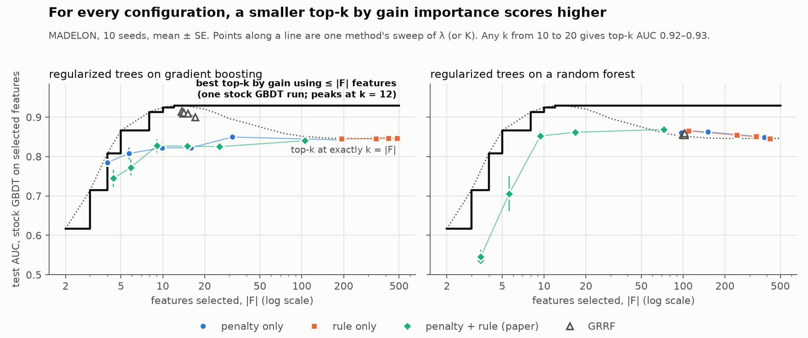

# Regularized trees vs. one argsort: a negative result

I implemented Deng & Runger's [Feature Selection via Regularized Trees](https://arxiv.org/abs/1201.1587)
as a native LightGBM feature: a ~300-line C++ fork of the tree learner, covering the gain penalty, the
candidate rule and the guided variant (GRRF). I then tested it against planted ground truth and the
MADELON benchmark.

**It does not earn its keep.** Under gradient boosting and under a random forest, every configuration
loses to the obvious cheap alternative: train one stock model, sort features by gain importance and
keep the top k. For each configuration, some top-k set is both smaller and more accurate.

<picture>
  <source media="(prefers-color-scheme: dark)" srcset="docs/frontier-dark.png">
  
</picture>

<sub>MADELON (NIPS 2003 feature selection challenge), 10 seeds. Every point is scored the same way: a
stock LightGBM retrained on only the selected columns. Reproduce with
`python -m trees_testing.frontier`; numbers are in [`results/frontier.json`](results/frontier.json).
The step line takes the best k in hindsight, but any k from 10 to 20 gives 0.92–0.93, so the choice
doesn't matter.</sub>

The decisive comparison is the complete published algorithm against top-k at the same number of
features, paired per seed. Settings were chosen on separate tuning seeds:

| full algorithm (penalty + candidate rule) | \|F\| | test AUC | matched top-k AUC | paired difference | seeds won |
| --- | ---: | ---: | ---: | ---: | ---: |
| on gradient boosting | 105.4 | 0.840 | 0.853 | −0.012 (SE 0.003) | 0 / 10 |
| on a random forest | 16.8 | 0.862 | 0.919 | −0.057 (SE 0.012) | 0 / 10 |
| *for scale: top-15 by gain* | 15.0 | **0.928** | | | |

## Findings

**1. Top-k by gain importance is a much stronger baseline than it looks.** One training run and an
`argsort` beat every configuration tested: the gain penalty alone, the candidate rule alone, both
together, and GRRF, which exists specifically to fix the failure described below. The papers'
baselines are CFS, FCBF, SVM-RFE, varSelRF and LASSO. Neither paper compares against importance
ranking at matched cardinality, which is the comparison that decides whether the machinery is worth
having. Comparing at matched k isn't the end of it, though. Top-k's AUC falls steeply past k ≈ 15, so
"beats top-k at its own k" is easy at large k and means little. Several random-forest settings do
exactly that at |F| ≈ 100, yet top-12 beats them with a tenth of the features. The figure therefore
measures each configuration against the best top-k that uses no more features.

**2. The paper's headline equation is half the algorithm.** Most descriptions of regularized trees
give the penalty: a feature not yet used has its split gain multiplied by λ. Algorithm 1 also changes
which features *compete* at each node. Every feature already in use is always a candidate, but only
⌈√M⌉ randomly drawn unused ones are, so a newcomer has to beat all of the incumbents to get in. My
first implementation had only the penalty. That was enough to produce a plausible-looking result,
and also a telltale symptom: at the paper's λ = 0.5 the penalty did almost nothing, and all the
dynamic range sat below λ ≈ 0.1. Adding the candidate rule ([E9](#the-experiments)) tests the real
algorithm, and the verdict does not change. The paper's own MADELON table points the same way: its
boosted variant does not significantly beat using all features, and CFS beats both of its variants
by a wide margin. ([details](docs/literature-check.md))

**3. The selected set only converges if *F* spans the whole ensemble.** The paper accumulates the
used-feature set *F* across trees. Reset it per tree, the natural reading of "penalise unused
features", and |F| never stops growing. λ then only changes the *rate* at which features enter, so
any |F| you quote is really a statement about `num_boost_round`. The fork's first implementation
had exactly this bug, and it produces publishable-looking numbers.

### What about random forests?

An earlier version of this README led with *"the method wins under a random forest 10/10 and loses
under boosting 10/10"*. That is true but misleading. The random-forest wins come from the penalty
alone and the rule alone, at |F| ≈ 108–110. At that size top-k scores only about 0.85, the same as
using all 500 features, so it is a low bar. Those settings had also not stopped adding features when
training ended, so their |F| is set by the number of rounds, not by the method. The complete
algorithm on a random forest selects a much smaller set, and there it loses to top-k on every seed.

## The experiments

`python -m trees_testing.run_milestones E1 … E9`. Each prints a `READ:` block explaining what the
numbers do and do not show.

| | question | verdict |
| --- | --- | --- |
| **E1** | Does \|F\| stop growing? | Only under `ensemble` scope. Under `tree` scope, never. |
| **E2** | Is the selected set the *right* set? | Structurally perfect on synthetic blocks; picks a correlated copy over the true driver ~1 block in 4. |
| **E3** | Does it beat top-k importance? | On synthetic linear designs, yes: +0.0264 AUC, 18/20 seeds. Ties L1. The one positive result, and it doesn't survive real data. |
| **E4** | Does it destroy interactions? | Yes. At the λ that selects cleanly, XOR AUC falls 0.953 → 0.584. |
| **E5** | What happens when p > n? | Fails badly: 5.2 of 7 picks are pure noise, worse than using all 600 features. |
| **E6** | A real benchmark (MADELON)? | Loses to top-k importance at every λ. GRRF improves it a lot, still loses. |
| **E7** | Is it at least faster? | No. The penalized fit is ~16% *slower*: it rescales gains already computed. |
| **E8** | Is boosting the problem? | Partly. The penalty alone beats matched top-k under a random forest, but only at large \|F\| (see above). |
| **E9** | Is it an artifact of implementing half the algorithm? | No. With the candidate rule added, the full algorithm loses under both base learners. |

## What makes the evaluation trustworthy

Feature selection is unusually easy to fool yourself about, so the harness is built to fail loudly:

- **Baselines are matched on cardinality and paired on seed**, and include the cheap alternative the
  method has to beat, not just random subsets or "all features".
- **Settings are tuned and reported on different seeds** (E9 and the frontier), so a winning
  configuration cannot be an artifact of picking the best of many on the same data.
- **The XOR probe suppresses its own results** when it lacks the power to detect what it claims to
  measure. Originally, destroying an interaction pair cost 0.008 accuracy, so `pairs_broken` could
  never have failed. It now measures intact-vs-broken AUC first (gap +0.512 after the fix) and
  refuses to report if the gap is too small.
- **"Converged" is separated from "saturated."** Vanilla LightGBM's |F| also stops growing, because
  every feature is in it. Treating that as selection would make the do-nothing baseline look like a
  selector. E1 reports `SELECTED`, `saturated` and `growing` as distinct outcomes.
- **Tree structure is reported alongside |F|.** Every selection metric is computed on the union of
  features across trees, which cannot see trees collapsing into single-feature stumps, the actual
  failure mode at small λ (measured: 1.01 features per tree). `tree_diagnostics` catches it.
- **The harness's own assumptions are tested.** `selection_curve` derives the whole |F|-vs-rounds
  curve from one fit, which relies on boosting being prefix-consistent. A test checks that against
  independently trained models.
- **Ground truth is verified, not trusted.** MADELON's real-feature indices were never published.
  They are recovered from correlation structure (redundant features correlate ~0.99 with their
  source; probes correlate with nothing), giving exactly 20 columns, the same 20 that top gain
  importance. The test suite checks that the two routes agree.

## Reproduce

```bash
uv sync
uv run pytest tests/ -q                                       # harness self-tests
uv run python -m trees_testing.frontier --plot-only           # redraw the figure from results/
uv run python -m trees_testing.frontier --seeds 10            # recompute it (needs the fork)
uv run python -m trees_testing.run_milestones E9 --seeds 10   # the full-algorithm head-to-head
uv run python -m trees_testing.run_milestones --seeds 20      # everything
```

`uv sync` installs the forked LightGBM (below) from its release and compiles it, so it needs
CMake, a C++ compiler and OpenMP (on macOS: `brew install libomp`). MADELON is fetched from OpenML
on first use.

## Layout

```
src/trees_testing/
  synthetic.py           # generators with planted ground truth (blocks, relevant/irrelevant, XOR)
  real_data.py           # MADELON + ground-truth recovery
  selection_harness.py   # metrics, baselines, convergence, tree diagnostics, GRRF plumbing
  run_milestones.py      # E1-E9
  frontier.py            # the headline figure
tests/
  test_harness_properties.py   # incl. the harness's own assumptions
results/                 # computed numbers behind the figure
docs/                    # figure, literature check
```

## The fork

The parameters live in a LightGBM fork,
[`LightGBM_RegularisedTrees`](https://github.com/whipwhipwhipwhip/LightGBM_RegularisedTrees), mostly in
`src/treelearner/serial_tree_learner.{h,cpp}`. This project pins its release
[`v4.6.0.99-rrf.1`](https://github.com/whipwhipwhipwhip/LightGBM_RegularisedTrees/releases/tag/v4.6.0.99-rrf.1);
`lightgbm.__version__` reports `4.6.0.99+rrf.1`.

| parameter | meaning |
| --- | --- |
| `unused_feature_penalty` | λ ∈ [0,1]. Split gain of a not-yet-used feature is multiplied by this. 1.0 = off. |
| `unused_feature_penalty_scope` | `tree` \| `ensemble`. Whether *F* resets per tree. **`ensemble` is the paper's semantics**; `tree` is the default for backwards compatibility and does not converge. |
| `unused_feature_penalty_candidates` | K. If set, every feature in *F* is a split candidate at every node and only K random features outside it are. The paper uses K = ⌈√M⌉. −1 = off. |
| `unused_feature_penalty_gamma` | γ ∈ [0,1] for GRRF: λᵢ = (1−γ)λ₀ + γ·Imp′ᵢ |
| `unused_feature_penalty_guide` | per-feature Imp′ᵢ = Impᵢ / maxⱼ Impⱼ from a preliminary model |

## Limitations

- One real benchmark. MADELON suits the question (nonlinear, redundant, 96% noise, recoverable
  ground truth), but conclusions from a single dataset should be held loosely.
- The paper's boosted variant is AdaBoost over random trees, not gradient boosting. The random-forest
  arm uses LightGBM's `boosting=rf`, which keeps leaf-wise growth and differs from the paper's
  implementation.
- GRRF's guide is always a stock GBDT's importance, even when the selector is a random forest. That
  is the stronger guide, so it favours GRRF.
- The cached-split staleness described in the fork's design notes is unaddressed.

## References

- Deng & Runger, [Feature Selection via Regularized Trees](https://arxiv.org/abs/1201.1587) (IJCNN 2012)
- Deng & Runger, [Gene Selection with Guided Regularized Random Forest](https://arxiv.org/abs/1209.6425) (2013)
- Guyon et al., NIPS 2003 feature selection challenge (MADELON)
